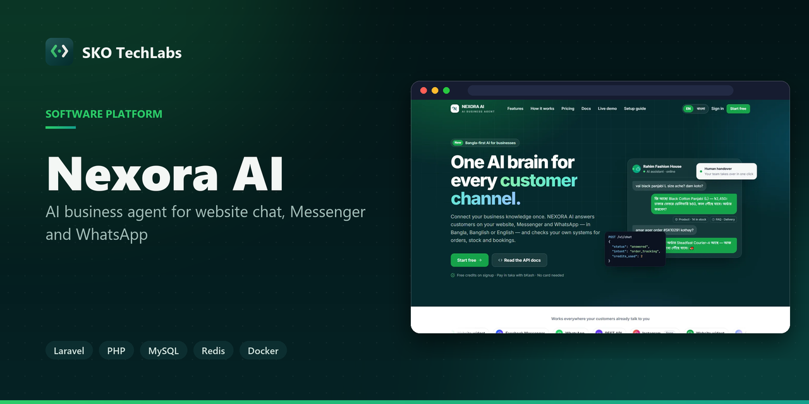
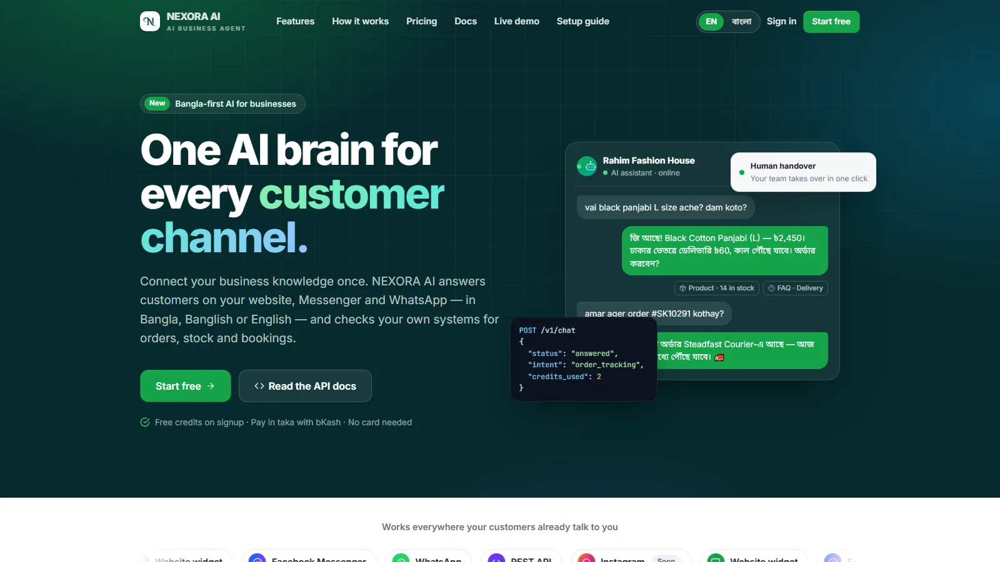

<h3>AI business agent for website chat, Messenger and WhatsApp</h3>

A multi-tenant platform that gives every business its own AI agent — answering customers on the website, Messenger and WhatsApp from its own catalogue, with credits, limits and a shared inbox.

   

<a href="https://aiagent1.skotechlabs.com"><b>Live Demo</b></a> &nbsp;·&nbsp; <a href="https://skotechlabs.com/projects/nexora-ai-business-agent-platform"><b>Case Study</b></a> &nbsp;·&nbsp; <a href="https://skotechlabs.com/contact"><b>Request a Demo</b></a> &nbsp;·&nbsp; <a href="https://github.com/skotechlabs"><b>All Products</b></a>

---

## Overview

A multi-tenant platform that gives every business its own AI agent — answering customers on the website, Messenger and WhatsApp from its own catalogue, with credits, limits and a shared inbox.

<table>
<tr>
<td width="50%" valign="top">

### The Challenge

A shop owner boosts a post and wakes up to two hundred messages, most of them the same four questions, many of them a product photo asking whether the item is in stock, and some of them voice notes. Replying late loses the sale; hiring someone to reply all night costs more than the margin. Off-the-shelf chatbots answer with keywords, invent prices and cannot be trusted with a real catalogue.

</td>
<td width="50%" valign="top">

### Our Solution

One agent per business, grounded in data that belongs to that business. It reads product photos, transcribes voice notes, answers in the language the customer used, and quotes prices only from the catalogue. It calls the connected systems for anything live, hands over to a human when it is unsure, and every reply is metered against credits the owner controls.

</td>
</tr>
</table>

## Key Features

- Per-business AI agent with its own knowledge base and tone
- Website chat widget installed with a single script tag
- Messenger and WhatsApp Cloud API channels
- Comment auto-reply on boosted posts, with an on/off switch
- Product photo recognition against the business catalogue
- Voice note transcription and reply
- Tool calling into connected order and stock APIs
- Shared team inbox with handover and internal notes
- Credit system with top-up by bKash and Nagad
- Super-admin approval gate on new signups
- Playground for testing the agent before it goes live
- Full REST API with publishable and secret keys

## Business Impact

- Website, Messenger and WhatsApp answered from one knowledge base
- Product photos matched to the catalogue instead of ignored
- Voice notes transcribed and answered like typed questions
- Every reply metered, with per-business credit limits
- Strict tenant isolation, so no business can read data from another
- New signups held for approval, so free trials cannot be farmed

## Screenshots

<table>
<tr>
<td width="50%" valign="top"> Nexora AI: AI business agent for website chat, Messenger and WhatsApp</td>
<td width="50%"></td>
</tr>
</table>

> See it running: **[aiagent1.skotechlabs.com](https://aiagent1.skotechlabs.com)**

## Technology Stack

## Source Code & Licensing

This repository is the public showcase for **Nexora AI**. The production source code is proprietary and is maintained privately by SKO TechLabs.

Interested in this product for your business? We offer:

- **Ready-to-launch deployment** of Nexora AI under your own brand and domain
- **Customisation** of features, workflows, languages and integrations to fit how you work
- **Custom development** of a new product built on the same foundations
- **Ongoing support**, hosting, maintenance and feature roll-outs after launch

## Get in Touch

---

© 2026 <a href="https://skotechlabs.com">SKO TechLabs</a> · Dhaka, Bangladesh · Building intelligent digital solutions

